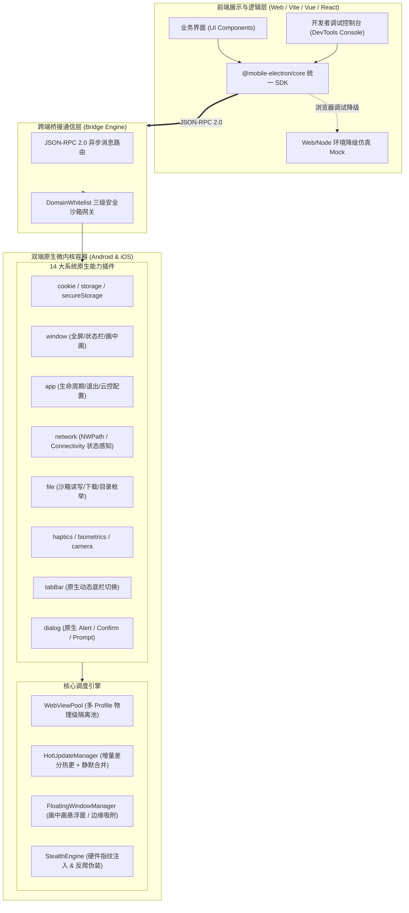

# Mobile Electron 全景架构与开发者实战指南

> **版本**：v2.0.0 Enterprise Release  
> **适用平台**：Android (API 24+) & iOS (14.0+)  
> **设计哲学**：**Shell is Engine, UI is Web（原生即引擎，界面皆网页）**

---

## 一、 整体技术架构设计

Mobile Electron 是一套基于微内核架构的企业级跨端混合开发容器。前端工程师可以使用任意 Web 框架（Vue 3、React、Vite、Svelte 等），通过强类型的 `@mobile-electron/core` SDK，像在桌面端开发 Electron 应用一样无缝操控底层原生特权能力。

### 1. 架构拓扑图



---

## 二、 14 大核心特权模块与 SDK 接口速查

前端引入方式：
```bash
npm install @mobile-electron/core
```
```typescript
import { electron } from '@mobile-electron/core';
```

| 模块名 | 作用描述 | 核心方法 / 特性 | 权限等级 |
| :--- | :--- | :--- | :--- |
| **`electron.app`** | 应用元信息、生命周期监听与云控配置 | `getInfo()`, `onStateChange(fn)`, `getConfigStatus()`, `fetchRemoteConfig()` | Tier 0 / Tier 1 |
| **`electron.network`** | 原生网络连通性与类型监听 | `getStatus()`, `onNetworkChange(fn)` | Tier 0 |
| **`electron.window`** | 沉浸式状态栏、全屏与画中画悬浮窗 | `setStatusBar()`, `createFloatingWindow()`, `minimizeFloatingWindow()` | Tier 1 |
| **`electron.cookie`** | 原生 Cookie 全量读写（支持 HttpOnly） | `getAll()`, `set()`, `remove()`, `clear()` | Tier 1 |
| **`electron.storage`** | 轻量级沙箱 Key-Value 存储 | `get()`, `set()`, `remove()`, `clear()`, `keys()` | Tier 0 |
| **`electron.secureStorage`** | 硬件级加密安全存储 (KeyStore / KeyChain) | `setItem()`, `getItem()`, `removeItem()` | Tier 1 |
| **`electron.file`** | 本地私有沙箱文件系统读写 | `readText()`, `writeText()`, `download()`, `list()` | Tier 1 |
| **`electron.hotUpdate`** | 离线包增量差分拉取与前台静默热更 | `checkUpdate()`, `downloadAndApply()`, `onUpdateReady()` | Tier 1 |
| **`electron.browser`** | 独立多页面调度与物理 Profile 分区 | `newPage()`, `switchPage()`, `evaluate()`, `closePage()` | Tier 1 |
| **`electron.tabBar`** | 原生底部标签栏动态配置与徽标更新 | `setItems()`, `setSelected()`, `setBadge()`, `onTabClick()` | Tier 1 |
| **`electron.biometrics`** | 生物识别鉴权（指纹 / 面容 Face ID） | `isAvailable()`, `authenticate()` | Tier 1 |
| **`electron.haptics`** | 真实触觉反馈震动 (Taptic Engine) | `impact()`, `notification()`, `selection()` | Tier 0 |
| **`electron.camera`** | 系统相机拍照与二维码扫码 | `takePhoto()`, `scanBarcode()` | Tier 1 |
| **`electron.ipc`** | 跨窗口全双工通信总线 (定向/广播/监听) | `send()`, `sendTo()`, `broadcast()`, `on()`, `once()` | Tier 0 |
| **`electron.dialog`** | 原生风格系统提示与交互弹窗 | `alert()`, `confirm()`, `prompt()` | Tier 0 |

---

## 三、 画中画与悬浮多窗口（Floating Window）最佳实践

针对移动端单屏交互场景，Mobile Electron 创新性地提供 **应用内微型视窗（In-App Overlay）** 架构。

### 1. 核心调用示例
```typescript
import { electron } from '@mobile-electron/core';

// 1. 创建画中画悬浮小窗（例如悬浮视频播放器）
const floatWin = await electron.window.createFloatingWindow({
  id: 'mini_video_player',
  url: 'https://m.bilibili.com/video/BV1xx411c7mD',
  title: '悬浮视频小窗',
  width: 300,
  height: 200,
  x: 40,
  y: 90,
  draggable: true,      // 允许手指自由拖拽
  showControls: true    // 显示标题栏、最小化和关闭按钮
});

// 2. 最小化为微型悬浮球 (Bubble)
await electron.window.minimizeFloatingWindow('mini_video_player', true);

// 3. 向画中画小窗执行 JS 脚本进行联动通信
const pageTitle = await electron.window.evalFloatingWindow(
  'mini_video_player',
  'document.title'
);

// 4. 关闭悬浮窗
await electron.window.closeFloatingWindow('mini_video_player');
```

### 2. 架构合规优势
- **免敏感高危权限**：不申请 Android 的 `SYSTEM_ALERT_WINDOW`（该权限在 Google Play / 国内应用商店极其敏感甚至被当成病毒拦截），直接在宿主 Activity / UIViewController 根容器上渲染，**100% 免权限弹窗，开箱即用，过审零风险**。
- **物理边界吸附**：原生内置边缘阻尼回弹，手指抬起时自动吸附在屏幕边缘，不遮挡主操作核心视区。

---

## 四、 增量差分热更新与静默合并机制

### 1. 工作原理
1. **构建清单 (Manifest)**：打包时计算所有静态资源的 SHA-256 哈希值，生成 `manifest.json`；
2. **差分比对 (Diff Engine)**：检查更新时比对本地清单与远程最新清单，仅拉取修改或新增的文件；
3. **前台静默拉取 (Silent Foreground Update)**：
   - 当用户将 App 从后台切回前台（`onResume` / `didBecomeActive`）时，原生容器自动触发防抖（30s）检查；
   - 若检测到差分更新，在后台静默下载合并到私有沙箱 `files/hotupdate/staging/`；
   - 完成后分发 `electron.hotUpdate.onUpdateReady` 事件，业务层可提示“已在后台备妥更新，下次启动或点击立即生效”。

### 2. 业务层监听更新示例
```typescript
electron.hotUpdate.onUpdateReady((evt) => {
  console.log(`新版本 ${evt.version} 静默热更已就绪，安装方式: ${evt.installMode}`);
  // 可在界面展示轻量横幅，引导用户点击重启生效
});
```

---

## 五、 应用商店上架（App Store & Google Play）合规指南

针对用户关心的“热更新与混合架构是否影响审核上架”，以下为官方合规权威指南：

### 1. 苹果 App Store 审核准则（Guidelines 2.5.2 & 3.3.2）
- **官方规定**：只要不改变 App 的**核心功能与主要目的**，使用系统内置 JavaScriptCore / WebKit 解释执行的 JavaScript 代码以及 HTML/CSS 资源的动态更新是**完全合规且被明确允许**的。
- **合规红线**：
  - 严禁通过热更新引入违规功能（如绕过 IAP 内购、私自加入博彩、新增与 App 分类无关的大型业务）；
  - 严禁包含 native 二进制代码（如私有 `.dylib`、`.so` 动态库）的下载执行。
- **Mobile Electron 合规保障**：
  - 本框架的 HotUpdate 仅更新沙箱内的 HTML/JS/CSS 静态前端资源；
  - 原生插件全部静态编译在 IPA/APK 中，无任何动态原生加载行为，完全符合苹果规范。

### 2. Google Play 开发者政策
- **官方规定**：Google Play 禁止通过任何方式绕过 Google Play 更新机制下载、安装或更新 **可执行代码（Executable Code）**，但通过 WebView 解释执行的 Web 静态内容属于合规豁免范围。

---

## 六、 CLI 工具链与常用命令汇总

项目自带面向全栈开发者的统一工具链：

```bash
# 1. 环境深度体检 (检测 OS、Node、JDK、Android SDK、ADB 及在线设备)
npm run doctor

# 2. 运行自动化全栈测试套件 (契约协议、SDK Mock、增量差分算法、沙箱白名单)
npm test

# 3. 编译 TypeScript SDK
npm run build:sdk

# 4. 编译 Web 控制台
npm run build:web

# 5. 本地离线模式预处理 (编译并同步到 Android assets 与 iOS bundle)
npm run mode:local

# 6. 在线远程 URL 模式切换
npm run mode:online

# 7. 一键真机 / 模拟器部署安装并自动映射 DevTools 调试端口
npm run run:android
# (秒级热跑复用已有APK: npx mobile-electron run android --skip-build)
# (启动并实时监听原生 Logcat 日志: npx mobile-electron run android --log)

# 8. 编译 Android Debug 安装包
./gradlew assembleDebug
# (产物输出至: app/build/outputs/apk/debug/app-debug.apk)

# 9. 编译 Android Release 签名包
./gradlew assembleRelease
```
