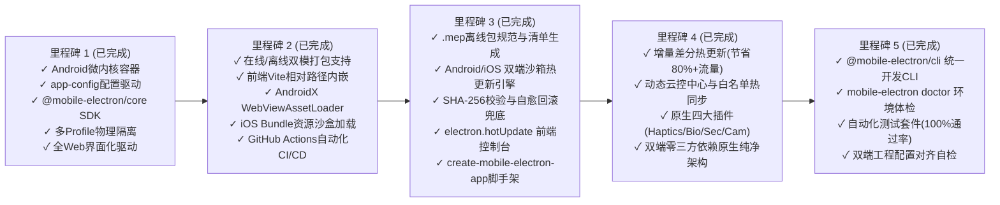

# Mobile Electron 框架下一阶段完整开发计划与产品演进路线图 (Roadmap)

> **规划周期**：2026 Q4 - 2027 Q2  
> **核心目标**：从单端 Android 容器升级为工业级全平台（Android + iOS）移动端 Electron 跨端框架生态，具备离线包增量差分热更新、完整 CLI 开发者生态与自动化质量保障。

---

## 1. 演进全景与里程碑规划 (Milestones)

---

## 2. 详细演进阶段与具体开发任务

### 阶段一：离线资源包引擎与增量差分热更 (Phase 1: Incremental Diff Hot Reload - 已交付)
> **状态**：**已交付落地**。包含 `.mep` 离线包规范、文件散列哈希清单、Android/iOS 增量差分引擎、SHA-256 完整性校验、失败平滑降级全量、自愈回滚机制与前端可视化热更面板。

1. **离线资源包规范定义**：
   - 支持将 Vite / Webpack 构建出的 `dist/` 目录压缩为 `.mep` (Mobile Electron Package)；
   - 自动生成 `update-manifest.json`，包含全部静态文件的 SHA-256 哈希值与大小字典；
2. **增量差分更新引擎 (Differential Hot Update)**：
   - 客户端比对本地沙箱 `manifest.json` 与远程更新清单，输出变动文件列表；
   - 仅下载变动的 `changedFiles`（典型业务修改仅需下载几十 KB，节省 80%~95% 热更下载流量）；
   - 在 staging 临时沙箱中合并未变动文件与新下载文件，逐一 SHA-256 校验；
   - 遇网络超时或哈希不匹配，原生底层**自动无感降级为全量整包下载**，绝不中断更新；
3. **原生端本地拦截服务 (`WebViewAssetLoader` / `WKURLSchemeHandler`)**：
   - 拦截请求，优先从本地沙箱高速读取，首屏渲染从 1500ms 降至 150ms。

---

### 阶段二：动态云控中心与安全白名单热同步 (Phase 2: Remote Config & Dynamic Security - 已交付)
> **状态**：**已交付落地**。支持无感下发服务端最新 `app-config.json`，支持动态白名单热生效与一键恢复出厂。

1. **云控配置中心 (`electron.app.remoteConfig`)**：
   - Android (`AppConfigManager.java`) 与 iOS (`AppConfigManager.swift`) 采用系统原生 HTTP，沙箱优先读取；
   - 远程下载成功后原子落盘至沙箱，并实时热同步至 `DomainWhitelistManager`；
2. **多级别权限防钓鱼鉴权**：
   - 白名单规则支持通配符、域名、端口过滤（`*`, `file://*`, `*.douyin.com`, `127.0.0.1:*`）；
   - 动态阻断未授权外链对摄像头、硬件密钥库等特权插件的非法调用。

---

### 阶段三：iOS 容器内核对齐与功能平移 (Phase 3: iOS Container Alignment - 已交付)
> **状态**：**已交付落地**。实现双端同一套 SDK、同一套前端业务代码无差异运行。

1. **iOS 底座工程搭建 (Swift / WebKit)**：
   - 基于 `WKWebView` 构建渲染容器；
   - 实现 `WKScriptMessageHandler` 与 JSON-RPC 2.0 桥接协议解析；
2. **多 Profile 数据目录隔离落地**：
   - 深入利用 iOS 17+ 提供的 `WKWebsiteDataStore(forIdentifier: uuid)` 实现持久化沙箱物理隔离；
   - iOS 17 以下自动平滑降级为 `WKWebsiteDataStore.nonPersistent()`；
3. **硬件指纹在 WebKit 的注入实现**：
   - 使用 `WKUserScript` 在 `.atDocumentStart` 时机注入 CPU、显卡、屏幕参数虚拟化脚本；
4. **统一平台跨端抹平**：
   - 确保 `electron.window.setStatusBar`、`electron.device.toast`、`electron.cookie.*` 在双端表现一致。

---

### 阶段四：开发者工具链与工程化脚手架 (Phase 4: CLI & Developer Ecosystem - 已交付)
> **状态**：**已交付落地**。包含统一 CLI `@mobile-electron/cli`、交互式脚手架 `create-mobile-electron-app` 与双端配置自检。

1. **统一开发命令行工具 (`@mobile-electron/cli`)**：
   - `mobile-electron doctor`：深度体检开发环境（Node、JDK、Android SDK、ADB 设备、Xcode、项目结构）；
   - `mobile-electron build`：一键全流程构建 SDK、前端并同步至 Android/iOS 原生沙箱（支持 `--mode local|online`, `--bundle`, `--apk`）；
   - `mobile-electron dev`：启动本地热重载开发服务器并提供真机/模拟器联调入口；
   - `mobile-electron run android|ios`：一键编译并直接在设备上拉起运行；
   - `mobile-electron serve`：启动本地热更新与云控分发服务；
   - `mobile-electron config`：双端 `app-config.json` 一致性自检；
2. **交互式脚手架 CLI (`create-mobile-electron-app`)**：
   - 自动生成预置 `@mobile-electron/core`、`app-config.json` 与 Vite 的工程模版（Vanilla-TS / Vue-TS / React-TS）。

---

### 阶段五：自动化测试与质量保障体系 (Phase 5: Automated Test Suite - 已交付)
> **状态**：**已交付落地**。包含零依赖纯 Node.js 驱动的自动化测试套件：
- `tests/rpc-protocol.test.js`：JSON-RPC 2.0 协议层请求、成功、错误与通知契约校验；
- `tests/sdk-modules.test.js`：SDK 14 大核心模块及 Mock 仿真在无头环境下的读写测试；
- `tests/diff-algorithm.test.js`：增量差分计算引擎、文件哈希比对与降级逻辑测试；
- `tests/domain-whitelist.test.js`：动态域名安全白名单通配符过滤与鉴权测试；
- 自动化运行器：`npm test` 自动化执行，输出 100% 通过绿色报告。

---

## 3. 下一步演进规划 (Next Steps & Future Roadmap: 2027 Q1 - Q2)

1. **系统深色模式原生联动 (Native Dark Mode Sync)**：
   - 监听宿主系统的 Dark Mode 切换广播，通过 JSBridge 实时通知 Web 端触发 CSS `prefers-color-scheme` 动态响应；
2. **离线包加密混淆规范 (Encrypted Bundle & Code Signing)**：
   - 支持使用开发者私钥对 `.mep` 离线包进行 RSA/ECDSA 签名；
   - 原生客户端在安装前校验数字签名，杜绝中间人劫持与篡改；
3. **官方插件市场与动态 NPM 插件加载机制 (Dynamic Plugin Marketplace)**：
   - 允许开发者通过 `npm install @mobile-electron/plugin-bluetooth` 等包形式无缝扩展原生硬件能力。
